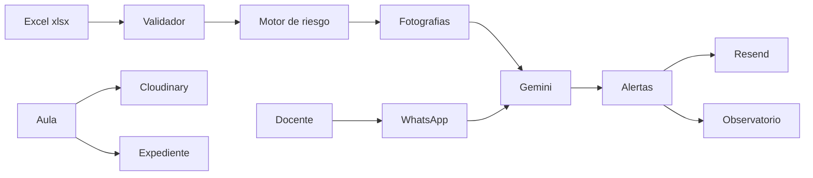

# Arquitectura

Aula 360 es una aplicación Next.js (App Router) en un solo servicio Node. PostgreSQL guarda personas, fotografías académicas, aula, alertas y mensajes. Los binarios van a Cloudinary. El disco de Render no se usa como almacén.

## Módulos

- **Ingesta.** Solo Bienestar. Si el archivo tiene errores, no hay escritura.
- **Riesgo.** Fórmula fija en `lib/risk/engine.ts`. La IA no calcula el puntaje.
- **Observatorio.** Última fotografía por estudiante, dentro del alcance del rol.
- **Aula.** Lista y entregas. Se muestran en el expediente con la etiqueta de actividad no oficial.
- **Mensajes.** Webhook firmado y envío por Graph API.
- **Reportes.** PDF con PDFKit y Excel con ExcelJS, generados en el servidor.

## Datos

La clave de persona es `codigo_estudiante`. Cada carga aceptada crea un `UploadBatch` y un `AcademicSnapshot` por fila. El estudiante se crea o se actualiza. El historial de fotografías permanece.

Cuentas:

- Bienestar nace con `npm run seed`.
- Docente y estudiante nacen al procesar el Excel, con clave temporal por correo, solo si el correo no existe.
- Si el correo ya pertenece a otro rol, no se cambia el rol ni se reasigna la cuenta.

## Fórmula

Puntaje 0 a 100, redondeado:

- 30% inasistencia
- 25% evaluaciones perdidas / programadas
- 20% semanas sin asistir, con tope de 4
- 15% materias reprobadas, con tope de 4
- 10% promedio por debajo de 3.0, en escala 0 a 5

Bandas: bajo 0–24, medio 25–49, alto 50–74, crítico 75–100.

Aviso:

- Bajo: nunca.
- Crítico: siempre, a Bienestar y al docente.
- Medio y alto: lo decide Gemini. Si la IA falla, alto avisa y medio no.
- Bienestar recibe alto y crítico. El docente recibe el aviso cuando la decisión es afirmativa, también en medio.

## Canales

- Correo: HTML propio, logo en `APP_URL/brand/logo.jpg`, remitente `MAIL_FROM` sin espacios sobrantes.
- WhatsApp: plantilla para abrir contacto. El texto libre solo se envía si el estudiante ya respondió y la ventana de 24 horas sigue abierta. Con turno humano activo, Gemini no contesta.
- Gemini usa el endpoint compatible con OpenAI definido en `AI_BASE_URL`.

## Navegación

La landing monta un patio 3D. Tras el ingreso, la órbita es un anillo con las estaciones del rol. Quien tenga `prefers-reduced-motion` ve la cinta horizontal de las mismas estaciones. El observatorio es una superficie de datos, no un canvas, para que las cifras se lean con exactitud.

## Despliegue

Un web service y una base, ambos gratis, región `oregon`. `output: standalone`. El script `scripts/prepare-standalone.js` copia `public` y `.next/static`. `GET /api/health` no toca la base, para que un monitor externo pueda mantener despierto el servicio sin gastar conexiones.

La base gratis caduca a los 30 días. El Excel se vuelve a cargar sobre la base nueva.
